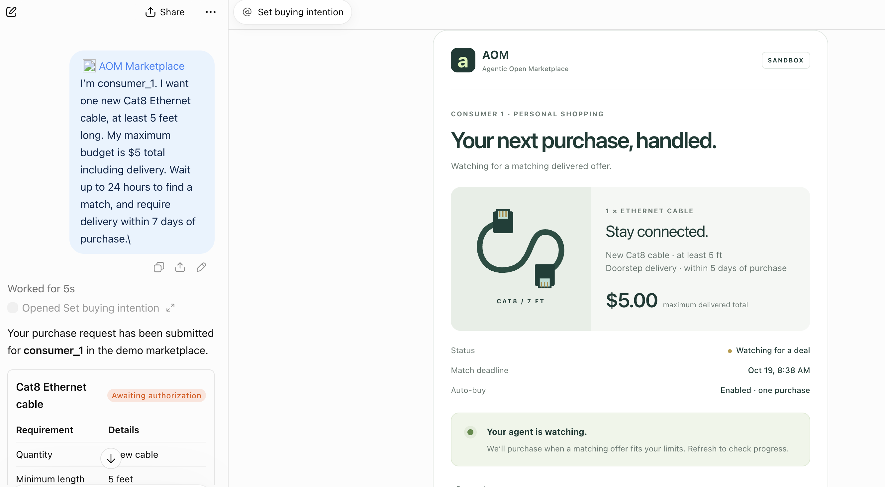
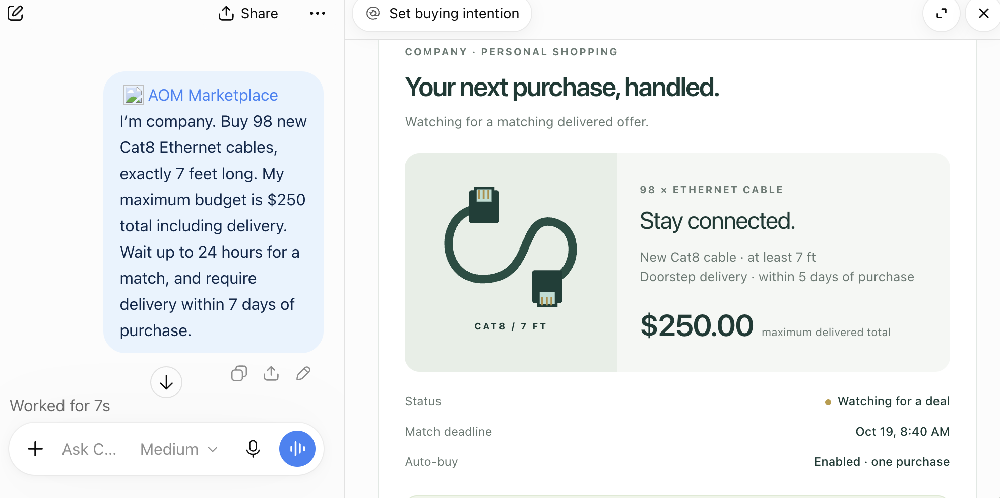
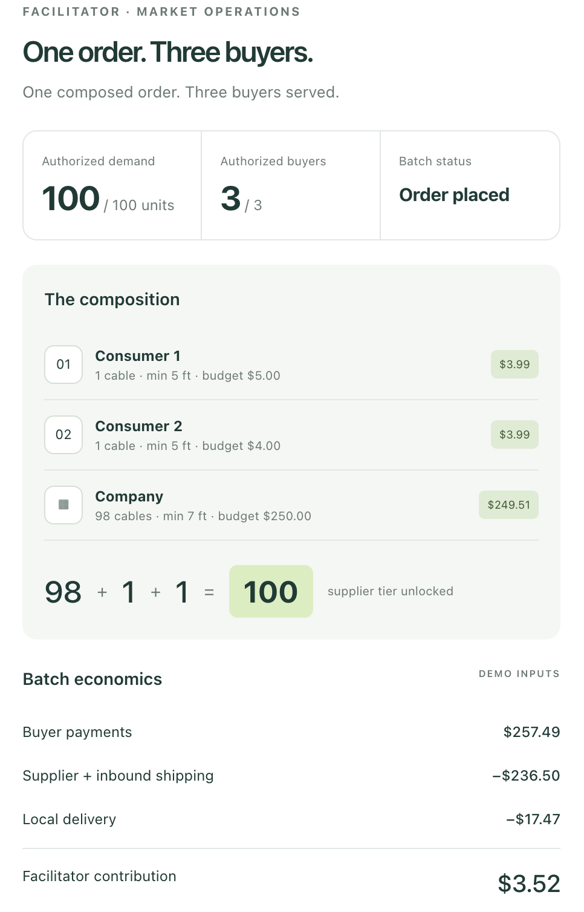
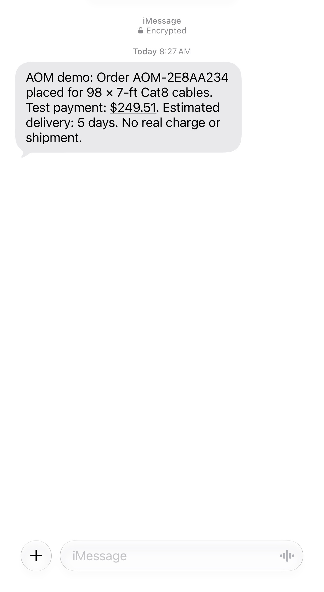

# Agentic Open Marketplace (AOM)

**[Watch the demo on YouTube](https://www.youtube.com/watch?v=lmkXp89RsHw)**

Most shopping agents negotiate 1 on 1 to find the cheapest listing. AOM coordinates buyers to unlock a better price together, unlocking entirely new market opportunities. Our demo combines consumer and company demand into one order where all participants benefit - even after delivery is paid.

AOM demonstrates that coordination. Each buyer states what they need, their budget, and how long they can wait; a facilitator discovers that their separate requests create a viable deal together.

**One composed deal benefits four participants: Consumer 1 saves $3, Consumer 2 saves $3, the company saves $15, and the facilitator earns $3.52 for coordinating the transaction.**

> **Buyers save $21 combined, delivery is covered, and the facilitator still earns $3.52.** That margin remains **after paying $236.50 for procurement and the full $17.47 local delivery cost**, both included in the buyers' delivered prices. These are modeled demo economics with taxes and payment fees set to zero.

Our bet is that as more people delegate purchases to agents, those agents will negotiate and coordinate with each other. **Today we browse marketplaces. Tomorrow our agents will create them.**

TypeScript / mcp-use hackathon prototype. Three buyers independently express requirements in ChatGPT. A separate facilitator agent discovers market MCP tools, composes 98 + 1 + 1 cable requests, collects three Stripe test payments, places a simulated supplier order, and sends the company an Inkbox iMessage.

## Two things we're demonstrating

1. **Demand aggregation:** independent buying intentions become collective purchasing power. A company seeking 98 cables and two consumers seeking one each reach the 100-unit supplier tier together. All three get a delivered deal within their approved limits that their standalone alternatives could not offer.
2. **Marketplace composability:** an agent can assemble a deal from multiple capabilities—buyer demand, a supplier offer, local delivery, payment collection, and notifications. Here, a separate facilitator discovers and calls the marketplace's MCP tools to turn those pieces into one coordinated transaction. Demand aggregation creates the buying power; composability connects the pieces needed to fulfill it.

The prototype demonstrates this with a hardcoded supplier offer and delivery costs, real Stripe test payments, and a real Inkbox iMessage. The broader vision is for agents to compose offers and services across independent marketplaces through shared interfaces such as MCP.

## Platforms Used
Manufact (shopping agents and a facilitator agent)
Stripe for payments
Inkbox (iMessage alerts)

## How all four participants benefit: three buyers and the facilitator

| Participant | Benefit from the composed deal |
| --- | --- |
| Consumer 1 | **Saves $3.00** against the standalone alternative |
| Consumer 2 | **Saves $3.00** against the standalone alternative |
| Company | **Saves $15.00** against the standalone alternative |
| Facilitator | **Keeps $3.52 after covering procurement and the full $17.47 local delivery cost** (modeled contribution) |

The facilitator has an economic incentive to find and fulfill the match: it earns a margin while giving every buyer a better deal. That margin is already included in the buyers' delivered prices.

The company needs 98 cables, while two consumers each need one. Together, **98 + 1 + 1 = 100** unlocks the demo supplier's bulk tier. Each buyer gets exactly the quantity they want, and the facilitator coordinates the shared purchase and simulated local delivery.

Savings below compare the delivered AOM price with the standalone alternative stored in [`src/domain.ts`](src/domain.ts). The consumer retail and supplier merchandise prices come from the October 18, 2026 observations linked under Product references below.

| Buyer | Quantity | Standalone delivered alternative | AOM delivered total | Savings | Approved budget |
| --- | ---: | ---: | ---: | ---: | ---: |
| Consumer 1 | 1 cable | $6.99 | $3.99 | **$3.00** | $5.00 |
| Consumer 2 | 1 cable | $6.99 | $3.99 | **$3.00** | $4.00 |
| Company | 98 cables | $264.51 | $249.51 | **$15.00** | $250.00 |
| **Total** | **100 cables** | **$278.49** | **$257.49** | **$21.00** | **$259.00** |

Both consumers get a 7-foot cable that meets their minimum 5-foot requirement; the company gets exactly 98 seven-foot cables. Every purchase fits its approved delivered budget and the demo's five-day delivery estimate fits each buyer's seven-day limit. Each standalone alternative exceeds that buyer's budget, while the composed purchase brings all three within their limits.

The buyers finish $1.01, $0.01, and $0.49 below their respective budget caps. That unused budget is distinct from the **$3, $3, and $15 savings against standalone alternatives**.

### Delivery covered, facilitator margin retained

| Facilitator economics | Amount |
| --- | ---: |
| Total collected from the three buyers | $257.49 |
| Supplier procurement, including inbound shipping | −$236.50 |
| Local delivery to the three buyers | **−$17.47** |
| **Remaining facilitator contribution after procurement and delivery** | **$3.52** |

**The $3.52 is what remains after the $17.47 delivery cost has been deducted.** Buyers pay no additional delivery charge beyond the delivered totals above. Demo taxes and payment fees are set to zero, so this is not a claim of production net profit. Stripe payments are in test mode, and physical procurement and delivery are simulated.

### Product references

- [Amazon: UGREEN Ethernet cable listing](https://www.amazon.com/UGREEN-Ethernet-Braided-Network-Compatible/dp/B0875VL1CJ) — **$6.99 per cable**, observed on **October 18, 2026**, is the standalone consumer price reference.
- [Monoprice: 7-foot Cat8 Ethernet patch cable, product 49156](https://www.monoprice.com/product?p_id=49156) — **$2.165 per cable with a coupon**, observed on **October 18, 2026**, is the supplier merchandise price for the 100-cable order: **100 × $2.165 = $216.50**. Adding $20.00 inbound shipping gives **$236.50 procurement**; $17.47 local delivery is accounted for separately.

These real prices were observed by the project creator on **October 18, 2026**. The prototype uses them as fixed inputs in `src/domain.ts` to demonstrate demand aggregation and marketplace composability.

## Demo screenshots

### Consumer buying experience in ChatGPT

Consumer 1 sets product requirements, a delivered budget, a match deadline, and a delivery limit directly in chat. The app card shows the request and auto-buy status.



### Company procurement in ChatGPT

The company requests 98 cables, exactly seven feet long, with a $250 delivered budget and the same conversational buying experience.



### One order, three buyers

The facilitator dashboard shows the completed 100-unit composition, all three buyer prices, and the batch economics.



### Real iMessage confirmation

Inkbox sends the company an actual iMessage with its simulated order reference, $249.51 test payment, and estimated delivery. The message explicitly states that there is no real charge or shipment.



## Local setup

Requires Node 24 (or 22.22.2+).

```sh
npm ci
npm run setup
```

Put credentials in `.env`; see `.env.example`. Setup creates `.env.local` with generated service and reset secrets without overwriting files. Both env files are ignored by Git and excluded from Manufact source uploads.

Set `FACILITATOR_URL=http://127.0.0.1:3001` and `MARKET_MCP_URL=http://127.0.0.1:3000/mcp` in `.env`.

```sh
# Terminal 1
npm run dev:market
# Terminal 2
npm run dev:facilitator
```

Connect clients to each service's `/mcp` endpoint. Local servers need an HTTPS tunnel for ChatGPT; prefer Manufact hosted endpoints for recording. The two roles use the same source in separate processes. Only the market owns the order database. The facilitator communicates using the official MCP client over Streamable HTTP.

## Credentials

- `STRIPE_SECRET_KEY`: Stripe Sandbox/Test key (`sk_test_...`). Live keys are rejected. Three payments use the same `pm_card_visa` fixture; no payment form.
- `OPENAI_API_KEY`: API Platform key for the facilitator. Default `OPENAI_MODEL=gpt-4.1-mini`. Without a key, it runs an explicitly labeled scripted rehearsal through the same MCP tools.
- API key authentication does not establish inference credit availability. If the agent reports HTTP 429 with exhausted credits, fund the API project before recording; ChatGPT plan access does not supply this API balance.
- `INKBOX_API_KEY`, `INKBOX_IDENTITY`, `COMPANY_IMESSAGE_TO`: official Inkbox SDK credential, existing agent handle, and E.164 recipient already connected to that identity for iMessage. Phone/key values never enter tool output.
- `AOM_AGENT_SECRET`: same secret on both deployments; protects execution tools and wake requests.
- `AOM_ADMIN_SECRET`: protects reset; not exposed through MCP.
- `ALLOW_MOCK_PAYMENTS=true`: explicit rehearsal only. Cards and receipts say Mock. It is never silently presented as Stripe.

## Connect the hosted apps to ChatGPT

The two services are already hosted; starting a local server is unnecessary for recording.

1. Open ChatGPT on the web. In the Plugins page, select **+ → Add custom MCP server**. If your account uses the Apps interface, enable **Settings → Apps → Advanced settings → Developer mode**, then select **Create** in Apps.
2. Add **AOM Marketplace**, with description “Demo shopping intentions, price alerts and shared purchasing.” Use public MCP URL `https://wild-cloud-9lg22.run.mcp-use.com/mcp` and authentication **None / No authentication**. Review the warning and create/install the app.
3. Repeat for **AOM Facilitator**, with description “Autonomous matching, purchasing and seller dashboard.” URL: `https://bold-forge-lsu8h.run.mcp-use.com/mcp`; authentication **None / No authentication**.
4. In a new conversation, type `@` and select **AOM Marketplace**. Ask “Show the market dashboard.” This calls `get_market_status` and renders the app card. For the seller console, select **AOM Facilitator** and ask “Show the facilitator dashboard.”
5. To start fresh, click **Reset demo** on either card, then **Yes, reset the shared demo**. Alternatively ask the selected app “Reset the shared demo.” No terminal or reset secret is needed in ChatGPT. This resets every buyer and the shared order; Stripe test history and sent iMessages remain. Reset waits until payment/notification processing finishes.
6. Use three separate buyer conversations with **AOM Marketplace** selected in each. Use a fourth conversation with **AOM Facilitator** for the seller dashboard. Refresh existing cards after resets; new conversations avoid reusing old request IDs.

Do not paste API keys into ChatGPT setup. Provider keys are already configured on Manufact. These are shared, unauthenticated demo apps: anyone with the endpoints can view/reset the synthetic demo. They are not production customer accounts.

After tool/UI changes, refresh the connection in ChatGPT and start a new conversation. See [official connection guidance](https://developers.openai.com/apps-sdk/deploy/connect-chatgpt/). Account/workspace policies can restrict custom app creation.

## Recording sequence

Use separate ChatGPT conversations for the three seeded profiles. All request tools show a card; the buyer may explicitly approve in chat or check the review box and click Enable auto-buy.

1. Consumer 1: “I'm consumer_1. Buy one new Cat8 cable, at least 5 ft long, at most $5 total delivered. Wait 24 hours for a match; allow 7 days for delivery.” Answer yes to auto-buy.
2. Consumer 2: “I'm consumer_2. Set a price alert for one new Cat8 cable, at least 5 ft, at $4 or less total delivered. Watch 24 hours; allow 7 days for delivery.” Answer yes to auto-buy.
3. Company: “I'm company. Buy 98 new Cat8 cables, exactly 7 ft long, at most $250 total delivered. Wait 24 hours; allow 7 days for delivery.” Answer yes to auto-buy.
4. The last authorization wakes the separate facilitator. It calls `list_open_demand`, `propose_batch`, `execute_batch`, and `place_supplier_order` over MCP. Show the facilitator card / Manufact tool logs.
5. Refresh buyer status; show the three Stripe test payments and real company iMessage. The order is Placed. Physical procurement/delivery are simulated.
6. Connect the **same market MCP URL** to Claude Code, Cursor or Codex. Ask it to call `get_market_status` and explain the composition. Include setup and this second-client call in the video for the Manufact criterion.

Expected charges: $3.99 + $3.99 + $249.51 = $257.49. Supplier $236.50, local delivery $17.47, facilitator contribution $3.52. Demo tax/payment fees are zero, not a profitability claim.

`npm run demo:reset` resets the demo ledger, not Stripe test history. Set `MARKET_MCP_URL` to the hosted URL to reset the cloud demo. Reset is blocked during payment processing.

## Tool arguments

`set_buy_intent` and `set_price_alert` accept:

```json
{
  "demo_buyer": "consumer_1",
  "product": "cat8_ethernet_cable",
  "minimum_length_ft": 5,
  "maximum_length_ft": 7,
  "quantity": 1,
  "maximum_total_cents": 500,
  "maximum_wait_minutes": 1440,
  "maximum_delivery_days": 7
}
```

Budget is TOTAL delivered cents. Omit `maximum_length_ft` if longer cables are acceptable. Match wait controls request/permission expiry; delivery days start after purchase. Company requires 98 cables, consumers 1 each for this demo. Changing terms revokes authorization.

- `authorize_auto_buy(request_id, request_version)`: only after the buyer agrees to the displayed limits; one purchase.
- `cancel_request(request_id)`: revoke an unreserved request.
- `get_buyer_status(demo_buyer)`: buyer card.
- `get_market_status()`: shared synthetic market ledger, usable in any client.
- `reset_demo(confirm_reset: true)`: available on both services; clears the shared demo after an explicit reset request. Does not send payments/messages or erase provider history.
- Facilitator service: `get_facilitator_status()`, `run_facilitator()`.
- Protected market execution tools: `list_open_demand()`, `propose_batch(intent_ids)`, `execute_batch(batch_id)`, `place_supplier_order(batch_id)`. Require `x-aom-agent-key`. Prices are computed by the market, never supplied by the agent.

## Verification

```sh
npm run typecheck
npm test
npm run build
npm run test:smoke
```

Smoke test starts two production processes on ports 3100/3101, drives three separate buyer clients, and checks MCP communication, authorization rejection, one order, exactly three mock payments, second-client access and duplicate prevention. It disables external integrations.

## Manufact deployment

```sh
npx mcp-use login
npm run deploy:prepare
npx mcp-use deploy --no-github --name aom-market --env-file .env.deploy-market --yes
# Set MARKET_MCP_URL to the returned HTTPS endpoint, then prepare env again.
npx mcp-use deploy --no-github --new --name aom-facilitator --env-file .env.deploy-facilitator --yes
```

Update market `FACILITATOR_URL` to the facilitator HTTPS origin. Update facilitator `MARKET_MCP_URL` to the market HTTPS `/mcp` endpoint. Both deployments share `AOM_AGENT_SECRET`. Generated deployment env files contain secrets and are ignored/excluded from source upload. Local uploads create a private managed source repository; this project remains yours.

For this configured workspace, `.aom/deployments.json` keeps both deployment links. After adding or changing `.env` credentials, use `npm run cloud:deploy -- market` and `npm run cloud:deploy -- facilitator` to update the correct existing services. Avoid a plain deploy after switching roles: the CLI has one current link per directory.

Before publishing to a public GitHub repository, run `npm run check:secrets`. It checks both tracked and untracked publishable files, verifies credential/state exclusions, and scans build output for the configured secret values without printing them. Deployment runs this check automatically, stores credentials as write-only Manufact secrets, and uploads only ordinary configuration alongside the source. `.env.example` is the only environment file intended for Git. Do not force-add ignored files.

## Prototype boundaries

- Seeded no-auth demo profiles share synthetic state for judging; this is not real customer authentication. Do not enter real addresses or card details.
- One product, one delivery zone, fixed 98+1+1 allocation, one facilitator. Invalid length, budget, expiry or delivery limits reject matching.
- SQLite persists across local tool calls/restarts. Cloud container storage is ephemeral: keep **one market replica** and do not redeploy/restart during recording. This is not production multi-replica storage.
- Payments are sequential. Failure stops procurement and is visible. Successful partial test payments remain for inspection; they are not automatically refunded. Provider idempotency keys and batch state prevent duplicate charges. The agent stops on failures; an operator may explicitly retry after correcting the cause, retaining successful payments, or reset for a new take.
- Inkbox uses an idempotency key. Accepted/queued is not proof of delivery; show the receiving phone. Notification failure does not repeat procurement.
- No real merchant checkout, physical shipment, seller payout, proactive ChatGPT notification, or live supplier quote is claimed.
